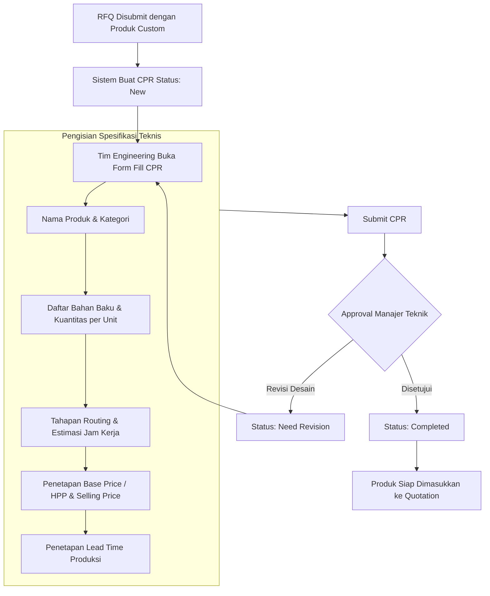
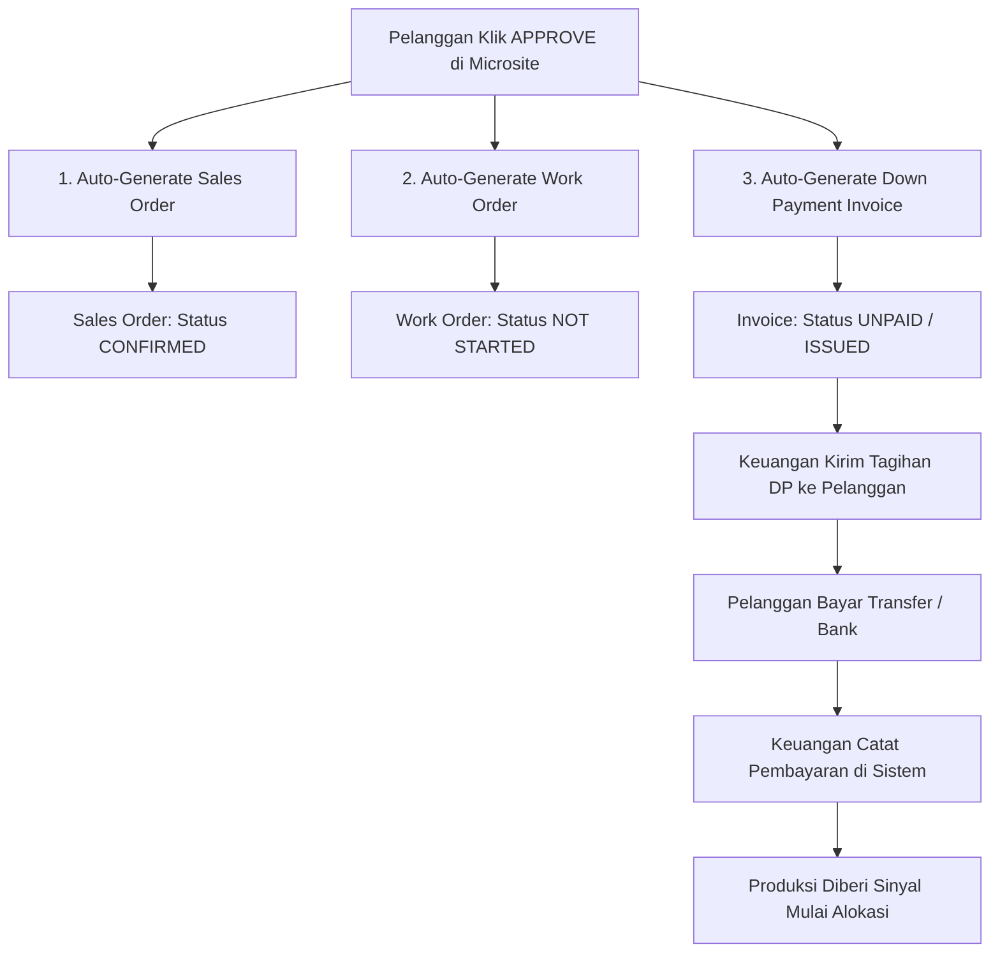
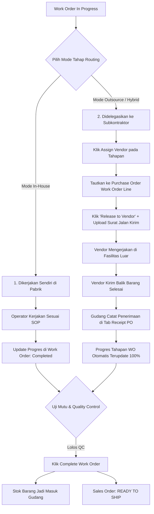
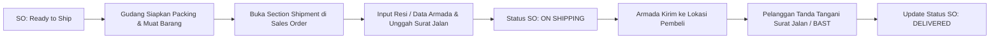

# BUKU PANDUAN OPERASIONAL LENGKAP: ALUR END-TO-END LABAMU MANUFACTURING (MRP)
## Dari Prospek Marketing, Negosiasi Penjualan, Rekayasa Desain, Eksekusi Pabrik, hingga Pengiriman & Pelunasan

**Sistem:** Labamu Manufacturing Resource Planning (MRP)  
**URL Akses:** `https://mrp.labamu.co.id/`  
**Fokus Panduan:** Standard Operating Procedure (SOP) & Alur Terintegrasi Antar-Divisi (*Marketing $\to$ Sales $\to$ Engineering $\to$ Procurement $\to$ Production $\to$ QC $\to$ Logistics $\to$ Finance*)

---

## DAFTAR ISI DETAIL
1. [BAB 1: Peta Alur Bisnis Menyeluruh (End-to-End Master Workflow)](#bab-1-peta-alur-bisnis-menyeluruh-end-to-end-master-workflow)
2. [BAB 2: Matriks Peran & Tanggung Jawab Antar-Divisi (RACI Matrix)](#bab-2-matriks-peran--tanggung-jawab-antar-divisi-raci-matrix)
3. [BAB 3: Fase 1 — Marketing & Akusisi Prospek (Inquiry $\to$ RFQ)](#bab-3-fase-1--marketing--akusisi-prospek-inquiry--rfq)
4. [BAB 4: Fase 2 — Pra-Penjualan, Simulasi & Rekayasa Teknis (Simulation & CPR)](#bab-4-fase-2--pra-penjualan-simulasi--rekayasa-teknis-simulation--cpr)
5. [BAB 5: Fase 3 — Penawaran Harga & Negosiasi Pelanggan (Quotation $\to$ Microsite)](#bab-5-fase-3--penawaran-harga--negosiasi-pelanggan-quotation--microsite)
6. [BAB 6: Fase 4 — Otomasi Persetujuan & Penagihan Uang Muka (SO, WO, DP Invoice)](#bab-6-fase-4--otomasi-persetujuan--penagihan-uang-muka-so-wo-dp-invoice)
7. [BAB 7: Fase 5 — Alokasi Bahan Baku & Pengadaan Material (Material Allocation & PO)](#bab-7-fase-5--alokasi-bahan-baku--pengadaan-material-material-allocation--po)
8. [BAB 8: Fase 6 — Eksekusi Lantai Produksi & Subkontrak (Shopfloor & Outsourcing)](#bab-8-fase-6--eksekusi-lantai-produksi--subkontrak-shopfloor--outsourcing)
9. [BAB 9: Fase 7 — Pengemasan, Pengiriman & Logistik (Packaging, QC & Shipping)](#bab-9-fase-7--pengemasan-pengiriman--logistik-packaging-qc--shipping)
10. [BAB 10: Fase 8 — Penagihan Akhir, Rekonsiliasi & Penutupan Order (Invoicing & Closing)](#bab-10-fase-8--penagihan-akhir-rekonsiliasi--penutupan-order-invoicing--closing)
11. [BAB 11: Panduan Pemecahan Masalah & Kontinjensi Lapangan (Troubleshooting)](#bab-11-panduan-pemecahan-masalah--kontinjensi-lapangan-troubleshooting)

---

# BAB 1: Peta Alur Bisnis Menyeluruh (End-to-End Master Workflow)

Diagram alur berikut menggambarkan interaksi lengkap antara 7 divisi organisasi dalam mengeksekusi pesanan:

```mermaid
sequenceDiagram
    autonumber
    actor MKT as 1. Marketing / Sales
    actor CUST as 2. Pelanggan (Customer)
    actor ENG as 3. Engineering / R&D
    actor PROD as 4. PPIC / Produksi
    actor PROC as 5. Pengadaan / Gudang
    actor LOG as 6. Logistik / Ekspedisi
    actor FIN as 7. Keuangan (Finance)

    %% Fase 1: Inquiry & RFQ
    MKT->>MKT: Terima Inquiry & Verifikasi Pelanggan + PIC
    MKT->>MKT: Buat & Submit RFQ di /rfq/

    %% Fase 2: Feasibility / CPR
    alt Produk Kustom (Custom)
        Note over MKT,ENG: Sistem otomatis generate CPR di /custom-products-request/
        ENG->>ENG: Rancang BOM, Routing, Jam Kerja, Lead Time & HPP
        ENG->>MKT: Submit & Approve CPR (Status: Completed)
    else Produk Standar
        MKT->>MKT: Jalankan Order Simulation (Cek Stok & Margin)
    end

    %% Fase 3: Quotation & Customer Approval
    MKT->>MKT: Terbitkan Quotation (Multi-Valuta FX, DP%, Incoterms)
    MKT->>CUST: Kirim Link Penawaran Resmi (Microsite)
    CUST->>MKT: Setujui Penawaran secara Digital di Microsite

    %% Fase 4: Auto Triggers
    Note over MKT,FIN: Sistem otomatis membuat Sales Order, Work Order, dan DP Invoice
    opt Jika Ada Down Payment (DP > 0%)
        FIN->>CUST: Kirim Faktur Uang Muka (DP Invoice)
        CUST->>FIN: Bayar DP & Konfirmasi
        FIN->>FIN: Catat Pembayaran di /invoices/
    end

    %% Fase 5: Alokasi & Procurement
    PROD->>PROD: Buka Work Order & Klik "Auto Allocate"
    alt Stok Gudang Kurang
        PROD->>PROC: Terbitkan Material Request di /material-requests/
        PROC->>PROC: Buat Purchase Order (PO Line: Material) ke Vendor
        PROC->>PROC: Catat Penerimaan Barang di Tab PO Receipt
        PROC-->>PROD: Stok Masuk Gudang -> Auto Allocate Berhasil
    end

    %% Fase 6: Eksekusi Produksi & Outsourcing
    PROD->>PROD: Mulai Produksi (WO Status: In Progress)
    loop Setiap Tahapan Routing
        alt Pengerjaan Internal (In-House)
            PROD->>PROD: Operator Kerjakan & Update Progres di WO
        else Pengerjaan Subkontrak (Outsource/Hybrid)
            PROD->>PROD: Assign Vendor & Tautkan ke PO Work Order
            PROD->>PROC: Release to Vendor (Kirim Barang + Surat Jalan)
            PROC->>PROC: Terima Hasil Subkontrak di Tab PO Receipt
            Note over PROC,PROD: Progres WO Otomatis Terupdate
        end
    end
    PROD->>PROD: QC Lolos & Klik "Complete Work Order"
    Note over PROD,LOG: Stok Barang Jadi bertambah; Order: Ready to Ship

    %% Fase 7: Pengemasan & Pengiriman
    LOG->>LOG: Siapkan Pengemasan & Buat Surat Jalan
    LOG->>LOG: Input Data Resi/Armada di Sales Order (Status: On Shipping)
    LOG->>CUST: Antar Barang & Minta TTD Surat Jalan / BAST
    LOG->>LOG: Update Status Order: Delivered

    %% Fase 8: Pelunasan & Penutupan
    FIN->>CUST: Terbitkan & Kirim Final Invoice Pelunasan
    CUST->>FIN: Pelunasan Sisa Tagihan
    FIN->>FIN: Catat Pelunasan (Settlement Progress: 100%)
    Note over FIN,MKT: Sales Order Otomatis Berstatus COMPLETED (Closed)
```

---

# BAB 2: Matriks Peran & Tanggung Jawab Antar-Divisi (RACI Matrix)

| Tahapan Operasional | Sales & Marketing | Engineering / R&D | PPIC / Produksi | Gudang & Purchasing | Logistik | Keuangan (Finance) | Pelanggan |
| :--- | :---: | :---: | :---: | :---: | :---: | :---: | :---: |
| **1. Identifikasi Prospek & Pembuatan RFQ** | **R / A** | C | I | I | I | I | C |
| **2. Rekayasa Teknis & Costing (CPR)** | C | **R / A** | C | C | I | C | I |
| **3. Simulasi Order & Estimasi Margin** | **R** | C | C | C | I | C | I |
| **4. Penerbitan & Negosiasi Quotation** | **R / A** | I | I | I | I | C | **R (Approve)** |
| **5. Penagihan Uang Muka (DP Invoice)** | I | I | I | I | I | **R / A** | **R (Pay)** |
| **6. Alokasi Bahan Baku & Material Request**| I | I | **R / A** | **R (Fulfill)**| I | I | I |
| **7. Pengadaan Bahan Baku (PO & Receipt)** | I | I | I | **R / A** | I | C | I |
| **8. Eksekusi Lantai Pabrik & Subkontrak** | I | C | **R / A** | C (Receipt PO) | I | I | I |
| **9. Quality Control & Penyelesaian WO** | I | C | **R / A** | I | I | I | I |
| **10. Pengemasan & Ekspedisi Pengiriman** | C | I | I | C | **R / A** | I | **R (Receive)**|
| **11. Faktur Pelunasan & Tutup Buku** | I | I | I | I | I | **R / A** | **R (Pay)** |

*Keterangan:* **R** = Responsible (Pelaksana), **A** = Accountable (Penanggung Jawab), **C** = Consulted (Konsultan/Diskusi), **I** = Informed (Penerima Laporan).

---

# BAB 3: Fase 1 — Marketing & Akusisi Prospek (Inquiry $\to$ RFQ)

## 3.1. Langkah Operasional Tim Marketing / Sales
1. **Penerimaan Kebutuhan Pembeli:**
   - Menerima pesanan/permintaan harga dari pembeli melalui WhatsApp, formulir website, email, atau pertemuan langsung.
2. **Pengecekan & Registrasi Master Data Pelanggan (`/customers/`):**
   - Cari apakah perusahaan pelanggan sudah terdaftar di sistem.
   - Jika belum, klik **New Customer**:
     - *Company Name, Email, Phone, Office Address*.
     - **Multi-PIC Setup (Maks 5 Orang):**
       - Masukkan Nama PIC, Email PIC, No. Handphone PIC.
       - Tentukan peran (*Role*): Pilih `Approver` (berhak menandatangani/menyetujui penawaran harga) atau `Viewer` (hanya melihat dokumen).
3. **Penerbitan Request for Quotation (RFQ) (`/rfq/create/`):**
   - Pilih nama pelanggan dari dropdown (data PIC dan alamat akan terisi otomatis).
   - Pilih PIC utama penerima dokumen.
   - **Pemilihan Produk:**
     - *Kasus A (Produk Standar):* Pilih produk dari katalog yang sudah ada.
     - *Kasus B (Produk Kustom):* Pilih tipe *Custom Product*, masukkan nama produk sementara (misal: *Tangki Stainless Steel 5000L Kustom*), kuantitas yang diminta, dan unggah dokumen gambar teknik / spesifikasi PDF dari pelanggan.
   - Masukkan *Customer Notes* (catatan yang akan tercetak di penawaran) dan *Internal Notes* (catatan rahasia untuk tim internal).
   - Klik **Submit** untuk mengajukan persetujuan internal sesuai aturan (*Approval Rules*).

---

# BAB 4: Fase 2 — Pra-Penjualan, Simulasi & Rekayasa Teknis (Simulation & CPR)

## 4.1. Jalur A: Produk Standar $\to$ Menjalankan Order Simulation (BETA) (`/order-simulation/`)
Sebelum mengirimkan harga penawaran ke pelanggan, tim Sales/PPIC wajib memvalidasi kelayakan kapasitas dan bahan baku:
1. Buka menu **Order Simulation BETA**.
2. Masukkan **Order Required Date** (target tanggal selesai yang diminta pelanggan).
3. Tambahkan produk yang diminta dan kuantitasnya.
4. Klik **Run Simulation**:
   - **Tab Production Planning:** Memeriksa apakah kapasitas total jam kerja mesin dan operator mencukupi sebelum *deadline*.
   - **Tab Material Forecast:** Sistem membedah formula BOM dan mencocokkan dengan stok fisik gudang saat ini. Jika ada bahan baku yang minus, sistem menampilkan daftar defisit stok (*Stock Shortage*) yang harus dibeli pengadaan.
   - **Tab Forecasted COGS:** Memverifikasi proyeksi marjin laba kotor (*Gross Margin %*). Jika marjin di bawah standar perusahaan (misal <25%), tim sales dapat menaikkan harga penawaran.

---

## 4.2. Jalur B: Produk Kustom $\to$ Alur Custom Products Request (CPR) (`/custom-products-request/`)
Jika RFQ mengandung produk kustom, sistem secara otomatis menerbitkan dokumen CPR berstatus `New`.



1. **Tindakan Tim Engineering / R&D:**
   - Buka dokumen CPR terkait dan klik **Fill CPR**.
   - Input nama resmi produk, kategori, dan satuan unit (UoM).
   - **Materials Section:** Masukkan seluruh material komponen yang dibutuhkan untuk membuat 1 unit barang.
   - **Routing Stages Section:** Tentukan tahapan fabrikasi (misal: *1. Potong Plat $\to$ 2. Roll Plat $\to$ 3. Las TIG $\to$ 4. Finishing $\to$ 5. Hydrotest*) beserta estimasi durasi jam kerja (*Hours*).
   - **Costing & Lead Time:** Tetapkan HPP (*Base Price*), harga jual yang direkomendasikan (*Selling Price*), dan estimasi waktu pembuatan (*Lead Time*, misal: 21 hari kerja).
   - Unggah gambar kerja CAD/PDF dan simpan.
2. **Persetujuan CPR:**
   - Manajer Teknik memeriksa kelayakan desain dan menekan tombol **Approve**.
   - Status CPR berubah menjadi `Completed`, dan tim Sales siap membuat Quotation.

---

# BAB 5: Fase 3 — Penawaran Harga & Negosiasi Pelanggan (Quotation $\to$ Microsite)

## 5.1. Penerbitan Dokumen Penawaran Resmi (`/quotes/create/`)
1. **Penarikan Data RFQ:** Tim Sales membuat penawaran baru dan memilih nomor referensi RFQ yang telah disetujui. Seluruh data pelanggan dan spesifikasi produk akan ditarik otomatis.
2. **Konfigurasi Finansial & Valuta Asing (FX):**
   - *Mata Uang Transaksi:* Pilih IDR, USD, SGD, EUR, dll. (Sistem mengonversi secara otomatis ke mata uang pembukuan utama).
   - *Down Payment %:* Masukkan persentase uang muka yang diwajibkan (misal: 30% atau 50%).
   - *Diskon & Biaya:* Masukkan diskon jika ada, tentukan tarif PPN (11%), biaya pengiriman (*Shipping Fee*), serta biaya instalasi/packing (*Other Fee*).
3. **Penyusunan Syarat Perdagangan & Hukum (*Terms & Conditions*):**
   - *Payment Terms:* Pilih NET 30, NET 60, Cash Before Delivery, atau termin khusus.
   - *Incoterms:* Pilih CIF, FOB, EXW, DDP. Sistem langsung mengkalkulasi *Risk Level* transaksi.
   - *Klausul Legal:* Aktifkan proteksi hukum standar:
     - `Force Majeure Clause` (Perlindungan atas bencana alam/keadaan kahar).
     - `Late Payment Penalty` (Denda atas keterlambatan pelunasan faktur).
     - `Performance Guarantee` (Jaminan mutu dan performa barang).
4. **Penerbitan Penawaran (*Issue to Customer*):**
   - Klik **Submit** untuk verifikasi internal Manajer Sales.
   - Setelah disetujui, status penawaran berubah menjadi `Issued`.
   - Sistem secara otomatis mengirimkan email resmi berisi tautan portal digital interaktif (**Microsite**) ke alamat email PIC Approver Pelanggan.

---

## 5.2. Interaksi Pelanggan pada Portal Microsite
Pelanggan membuka tautan *Microsite* di browser:
- Pelanggan dapat meninjau rincian spesifikasi teknis, harga satuan, jadwal pengiriman, dan klausul hukum.
- **Dua Keputusan Pelanggan:**
  1. *Request Revision:* Pelanggan mengetik catatan koreksi (misal: minta diskon tambahan atau perubahan termin). Status penawaran berubah menjadi `Need Revision`. Sales memperbaiki penawaran dan mengirim ulang.
  2. *Approve Quotation:* PIC berwenang (*Approver*) menekan tombol **Approve**.

---

# BAB 6: Fase 4 — Otomasi Persetujuan & Penagihan Uang Muka (SO, WO, DP Invoice)

Begitu pelanggan menekan tombol **Approve** di portal Microsite, sistem Labamu MRP secara instan menjalankan **3 otomasi paralel**:



## 6.1. Prosedur Penagihan Uang Muka oleh Divisi Keuangan
1. Buka menu **Sales $\to$ Invoices** (`/invoices/`).
2. Temukan invoice otomatis bertipe *Down Payment* yang terhubung ke nomor pesanan tersebut.
3. Kirimkan invoice resmi ke pelanggan dengan instruksi transfer bank.
4. Setelah dana masuk ke rekening perusahaan, buka invoice tersebut, klik **Add Payment**, masukkan nominal pembayaran, tanggal penerimaan kas, dan lampiran bukti transfer.
5. Status invoice berubah menjadi `Paid` (*Settlement: 100%*). Divisi Keuangan memberikan konfirmasi hijau kepada tim produksi.

---

# BAB 7: Fase 5 — Alokasi Bahan Baku & Pengadaan Material (Material Allocation & PO)

## 7.1. Prosedur Alokasi Bahan Baku oleh PPIC / Produksi
1. Buka menu **Manufacturing $\to$ Work Order** (`/work-orders/`) dan pilih nomor WO pesanan terkait.
2. Periksa tabel kebutuhan bahan baku (*Required Materials* vs *Allocated Quantity*).
3. Klik tombol **Auto Allocate**:
   - **Kondisi 1 (Stok Mencukupi):** Sistem secara otomatis memotong kuantitas dari *Stock Batches* yang ada di gudang. Status Work Order langsung berubah menjadi `Ready to Process`.
   - **Kondisi 2 (Stok Kurang / Defisit):** Sistem memberi notifikasi kekurangan stok. Kuantitas yang kurang ditampilkan jelas.

---

## 7.2. Alur Pengadaan Bahan Baku Defisit (Procurement via PO)

```mermaid
sequenceDiagram
    autonumber
    actor Prod as PPIC / Produksi
    actor Proc as Bagian Pengadaan (Purchasing)
    actor Vend as Pemasok (Vendor)
    actor Wh as Petugas Gudang (Warehouse)

    Prod->>Proc: Klik "Request Material" di Work Order (/material-requests/)
    Proc->>Proc: Buka /purchase-orders/create/ & Buat PO (Line: Material)
    Proc->>Vend: Kirim Dokumen PO Resmi (Status: Issued)
    Note over Proc,Wh: Sistem otomatis generate draft Stock Batch berstatus "Expected"
    Vend->>Wh: Kirim Fisik Bahan Baku + Surat Jalan
    Wh->>Wh: Buka PO Terkait di /purchase-orders/ & Buka Tab "Receipt"
    Wh->>Wh: Input Kuantitas di "Receive Now", Upload Foto Surat Jalan
    Wh->>Wh: Klik "Confirm Receipt"
    Note over Wh,Prod: Stok Batch berubah menjadi "Received"; Stok Fisik Bertambah
    Prod->>Prod: Buka Work Order & Klik Ulang "Auto Allocate"
    Note over Prod: Seluruh Material Terpenuhi -> Status: READY TO PROCESS
```

1. **Pengajuan Permintaan:** Operator menekan tombol **Request Material** dari dalam Work Order.
2. **Penerbitan Purchase Order Bahan Baku:**
   - Purchasing membuka `/purchase-orders/create/`.
   - Pilih vendor penyuplai, masukkan target kedatangan (*Expected Delivery Date*).
   - Tambahkan baris bertipe **Material**, pilih nama material, kuantitas, dan harga beli satuan.
   - Submit PO untuk persetujuan Manajer Purchasing $\to$ Status berubah menjadi `Issued`.
   - Sistem secara otomatis membuat entri batch stok baru berstatus `Expected`.
3. **Penerimaan Barang di Gudang (*PO Receipt Tab*):**
   - Saat kiriman vendor tiba di dermaga bongkar gudang, staf gudang membuka PO terkait dan masuk ke tab **Receipt**.
   - Masukkan jumlah barang yang secara fisik dihitung pada kolom **Receive Now**.
   - Unggah foto surat jalan vendor (*Delivery Note / Packing List*).
   - Klik **Confirm Receipt**. Kuantitas stok aktif gudang bertambah seketika.
4. **Alokasi Ulang:** PPIC membuka kembali Work Order dan menekan tombol **Auto Allocate**. Seluruh kebutuhan terpenuhi dan produksi siap berjalan.

---

# BAB 8: Fase 6 — Eksekusi Lantai Produksi & Subkontrak (Shopfloor & Outsourcing)

## 8.1. Memulai Proses Pabrikasi
1. Kepala Produksi membuka Work Order yang telah berstatus `Ready to Process`.
2. Klik tombol **Start Process**. Status Work Order resmi menjadi `In Progress`.

---

## 8.2. Eksekusi Berdasarkan Mode Tahapan Routing



### A. Prosedur Pengerjaan Internal (*In-House*)
- Operator mesin melakukan pengerjaan fisik di workstation (misal: mesin potong laser, mesin bubut, meja perakitan).
- Setelah selesai, mandor/operator membuka tahapan routing pada Work Order, mengklik **Manage**, memindahkan jumlah unit yang selesai ke kolom *Completed*, lalu menyimpan data.
manage
### B. Prosedur Pengerjaan Subkontrak (*Outsourcing / Hybrid*)
Jika ada tahapan pengerjaan yang tidak dapat dikerjakan internal (misal: proses *Hard Chrome Plating, Heat Treatment, Galvanizing*):
1. **Penugasan Vendor (*Assign Vendor*):**
   - Buka Work Order, cari tahapan routing yang akan disubkontrakkan.
   - Klik **Assign Vendor**.
   - Pilih nama vendor rekanan dari database.
   - Pilih *Included Steps* (bisa memilih beberapa tahapan sekaligus yang berurutan).
   - Masukkan *Assigned Output Quantity*.
   - Tautkan ke Purchase Order bertipe *Work Order* (pilih PO draft yang ada atau buat baru).
2. **Pelepasan Benda Kerja ke Vendor (*Release to Vendor*):**
   - Klik ikon **Release to Vendor**.
   - Masukkan jumlah unit barang setengah jadi yang dikirim ke vendor (*Release Qty*).
   - Unggah surat jalan pengeluaran barang pabrik (*Upload Proof Document*).
   - Klik **Submit*manage*. Status penugasan di sistem berubah menjadi `Waiting Receipt`.
   - *Catatan Penting:* Tanpa langkah pelepasan ini, sistem mengunci penerimaan di PO untuk mencegah manipulasi data.
3. **Penerimaan Hasil Pengerjaan Subkontrak:**
   - Ketika vendor mengirimkan kembali barang yang telah selesai diproses, staf gudang membuka Purchase Order terkait dan membuka tab **Receipt**.
   - Masukkan kuantitas yang diterima di kolom **Receive Now** dan unggah bukti surat jalan vendor.
   - Klik **Confirm Receipt**.
   - **Sinkronisasi Otomatis:** Kuantitas dan progres tahapan pada Work Order secara otomatis bertambah tanpa perlu diinput manual oleh tim produksi.
manage
---

## 8.3. Uji Mutu (Quality Control) & Penyelesaian Work Order
1. Petugas Quality Assurance (QA/QC) melakukan inspeksi dimensi, visual, dan fungsional terhadap produk akhir.
2. Jika seluruh tahapan routing telah mencapai 100% dan lolos standar mutu:
   - Kepala Produksi mengklik tombol **Complete Work Order**.
   - Status Work Order berubah menjadi `Completed`.
   - **Efek Sistem:** Kuantitas produk jadi (*Finished Goods*) langsung dicatatkan masuk ke dalam inventaris gudang barang jadi.
   - **Efek Penjualan:** Status Sales Order terkait secara otomatis diperbarui dari `In Progress` menjadi **`Ready to Ship`**.

---manage

# BAB 9: Fase 7 — Pengemasan, Pengiriman & Logistik (Packaging, QC & Shipping)

## 9.1. Prosedur Pengemasan & Pelabelan
1. Tim Gudang Barang Jadi menerima notifikasi pesanan berstatus `Ready to Ship`.
2. Lakukan pengemasan protektif sesuai standar produk (misal: wrapping plastik film, bantalan busa, peti kayu/pallet).
3. Tempelkan label identitas pesanan (Nama Pelanggan, Nomor Sales Order, Nama Produk, Kuantitas, dan Tanda Fragile jika diperlukan).

---

## 9.2. Pengiriman & Manajemen Ekspedisi (`/orders/`)
manage


1. Buka menu **Sales $\to$ Orders** (`/orders/`) dan buka pesanan yang akan dikirim.
2. Pada bagian **Shipment Section**, klik nomor/kode pengiriman (*Shipment Code*).
3. **Pengisian Data Ekspedisi & Logistik:**
   - *Shipping Methmanageod / Carrier:* Pilih armada internal pabrik atau ekspedisi pihak ketiga (misal: *Truk Engkel Perusahaan, JNE Trucking, Lalamove, Kargo Kapal Laut*).
   - *Tracking Number / No. Polisi:* Masukkan nomor resi ekspedisi atau nomor polisi armada pengantar.
   - *Actual Start Date:* Masukkan tanggal dan jam barang diberangkatkan dari pabrik.
   - *Surat Jalan:* Unggah salinan dokumen Surat Jalan resmi (*Delivery Order*).
4. Klik **Save**. Status pesanan secara resmi berubah menjadi **`On Shipping`**.

---

## 9.3. Serah Terima di Lokasi Pelanggan
1. Kurir/driver tiba di alamat gudang atau kantor pelanggan.
2. Petugas penerima dari pihak pelanggan memeriksa fisik barang dan mencocokkan dengan Surat Jalan.
3. PIC Pelanggan memanagenandatangani Surat Jalan dan Berita Acara Serah Terima (BAST).
4. Tim Logistik mengunggah foto Surat Jalan bertandatangan basah/stempel pelanggan ke dalam sistem dan mencatat *Actual End Date* (Tanggal barang diterima).

---

# BAB 10: Fase 8 — Penagihan Akhir, Rekonsiliasi & Penutupan Order (Invoicing & Closing)

## 10.1. Penerbitan Faktur Pelunasan (*Repayment Invoice*)
1. Tim Keuangan membuka pesanan pada menu **Sales $\to$ Orders** atau langsung melalui **Sales $\to$ Invoices $\to$ Create Invoice**.
2. Pilih jenis faktur **Repayment (Pelunasan)** dan pilih nomor Sales Omanagerder yang bersangkutan.
3. **Kalkulasi Nilai Otomatis:**
   $$\text{Tagihan Pelunasan} = \text{Total Nilai Pesanan (Termasuk Pajak & Ongkir)} - \text{Nilai Uang Muka (DP yang telah dibayar)}$$
4. Tetapkan tanggal jatuh tempo (*Due Date*) sesuai termin pembayaran (misal: *Cash on Delivery* atau *NET 30*).
5. Kirimkan dokumen faktur resmi beserta salinan Surat Jalan bertandatangan ke bagian *Accounts Payable* pelanggan.

---

## 10.2. Rekonsiliasi Pembayaran & Penutupan Pesanan (*Order Closed*)manage
1. Pelanggan melakukan pembayaran sisa tagihan via transfer bank.
2. Tim Keuangan membuka faktur pelunasan tersebut di `/invoices/`, mengklik **Add Payment**, memasukkan nominal pelunasan dan bukti transfer.
3. Status invoice berubah menjadi `Paid` (*Settlement Progress: 100%*).
4. **Penutupan Pesanan Otomatis:**
   - Sistem mendeteksi bahwa:
     $$\text{Barang Telah Terkirim (Delivered)} \quad \text{DAN} \quad \text{Seluruh Invoice Telah Lunas (100\% Paid)}$$
   - Status Sales Order secara otomatis berubah menjadi **`Completed`**.
   - Seluruh siklusmanage transaksi dari marketing hingga pengiriman resmi dinyatakan selesai (*Order Closed & Archived*).

---

# BAB 11: Panduan Pemecahan Masalah & Kontinjensi Lapangan (Troubleshooting)

### Skenario 1: Pelanggan Mengajukan Perubahan Desain saat Produksi Berjalan
- **Masalah:** Pelanggan meminta penambahan fitur pada saat Work Ordemanager sudah berstatus *In Progress*.
- **Prosedur:**
  1. Mandor pabrik menahan proses produksi pada tahapan terkait.
  2. Buka Work Order, gunakan fitur **Request Material** dengan kategori alasan `Non-BOM -> Design Change` untuk meminta material tambahan.
  3. Tim Sales menerbitkan Surat Perubahan Pesanan (*Change Order*) atau *Other Fee Invoice* tambahan jika ada kenaikan biaya yang disetujui pelanggan.

### Skenario 2: Terjadi Kerusakan Bahan Baku saat Fabrikasi (Scrap / Wastage)
- **Masalah:** Benda kerja cacat saat proses permesinan dan membutuhkan bahan baku pengganti melebihi formula resep BOM.
- **Prosedur:**
  1. Jangan memanipulasi master BOM asli.
  2. Dari halaman Work Order, ajukan **Material Request** dengan memilih kategori alasan `Exceeding BOM -> Material Wastage` atau `Rework`.
  3. Masukkan catatan investigasi teknis dan submit ke bagian gudang untuk pengeluaran bahan pengganti.

### Skenario 3: Vendor Subkontrak Mengirimkan Sebagian Barang (Partial Delivery)
- **Masalah:** Vendor pengerjaan finishing hanya mengirimkan 60 unit dari total 100 unit yang didelegasikan.
- **Prosedur:**
  1. Staf gudang membuka Purchase Order terkait dan membuka tab **Receipt**.
  2. Pada kolom *Receive Now*, ketik `60` (bukan 100).
  3. Konfirmasi tanda terima. Kuantitas tahapan pada Work Order otomatis terupdate 60 unit menjadi *Completed*, sedangkan sisa 40 unit tetap berstatus *In Progress / Waiting Receipt*.
  4. Ketika sisa 40 unit dikirim di kemudian hari, ulangi pencatatan *Receipt* untuk sisa kuantitas tersebut.

### Skenario 4: Rekonsiliasi 3-Way Matching Gagal pada Pembayaran Vendor
- **Masalah:** Faktur dari vendor mencantumkan tagihan 100 unit, namun gudang hanya mencatat penerimaan fisik 90 unit.
- **Prosedur:**
  1. Tab *3-Ways Match* pada PO akan menampilkan tanda silang merah (*Quantity Mismatch*).
  2. Bagian Keuangan wajib **menahan otorisasi pembayaran**.
  3. Hubungi vendor untuk menerbitkan faktur revisi (*Credit Note*) sebesar 90 unit atau menunggu pengiriman kekurangan 10 unit fisik sebelum pembayaran diproses.

---
*Buku panduan ini merupakan standar operasional prosedur (SOP) resmi alur kerja terintegrasi Labamu Manufacturing (MRP).*
