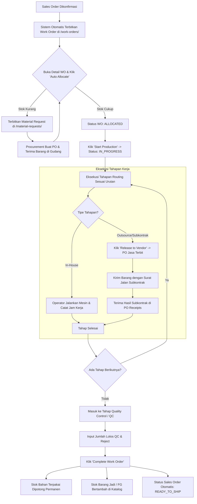

# PANDUAN LENGKAP PENGGUNAAN: ALUR PROSES PRODUKSI (MANUFACTURING GUIDE)
## Standard Operating Procedure (SOP) Eksekusi Produksi di Labamu MRP

Dokumen ini adalah panduan langkah-demi-langkah (*step-by-step user guide*) bagi tim **PPIC, Kepala Pabrik (Production Manager), Operator Lantai Produksi, dan QC Inspector** untuk mengeksekusi proses manufaktur dari Work Order hingga barang jadi siap kirim.

---

## 1. Peta Alur Produksi (Production Flowchart)

---

## 2. Langkah 1: Menerima & Meninjau Work Order (`/work-orders/`)

### A. Akses Modul
1. Buka menu sidebar **Manufacturing** $\to$ pilih **Work Order**.
2. Cari Work Order yang baru dibuat (Status awal: `PENDING_ALLOCATION`).
3. Klik tombol **Detail / View** pada baris Work Order tersebut.

### B. Memeriksa Spesifikasi Pesanan
- Periksa **Kode Produk** dan **Jumlah Unit (Quantity)** yang harus diproduksi.
- Periksa **Nomor Referensi Sales Order** dan **Target Tanggal Selesai (Target Due Date)**.
- Pastikan formula **Bill of Materials (BOM)** dan tahapan **Routing** yang terpasang sudah sesuai.

---

## 3. Langkah 2: Alokasi Bahan Baku (*Material Allocation*)

Sebelum mesin dinyalakan, bahan baku wajib di-reserve dari batch stok gudang untuk memastikan ketersediaan fisik.

### A. Eksekusi Auto Allocate
1. Pada halaman detail Work Order, temukan kartu **Materials Allocation**.
2. Klik tombol biru **"Auto Allocate Materials"**.
3. Sistem akan otomatis memindai stok batch di gudang (FIFO):
   - **Kondisi 1 (Stok Lengkap):**
     - Semua baris bahan baku berstatus hijau `Fulfilled`.
     - Status Work Order berubah otomatis menjadi **`ALLOCATED`**.
     - Tombol **"Start Production"** aktif dan siap diklik.
   - **Kondisi 2 (Stok Kurang / Defisit):**
     - Baris bahan yang kurang akan berwarna merah `Shortage`.
     - Muncul banner peringatan: *"Insufficient stock for MAT-XXX (Deficit: X unit)"*.

### B. Tindakan Kontinjensi Jika Bahan Kurang
1. Klik tombol **"Create Material Request"** langsung dari halaman Work Order.
2. Sistem akan menerbitkan tiket permintaan bahan di `/material-requests/`.
3. Tim Procurement akan membeli bahan via Purchase Order (`/purchase-orders/`).
4. Setelah barang diterima gudang (dicatat di *PO Receipts*), kembali ke Work Order dan klik ulang **"Auto Allocate Materials"**.

---

## 4. Langkah 3: Eksekusi Pengerjaan Lantai Pabrik (*Shopfloor Tracking*)

1. Klik tombol **"Start Production"**. Status Work Order berubah menjadi **`IN_PROGRESS`**.
2. Buka tab **Routing Progress**. Kerjakan tahapan secara berurutan:

### A. Tahapan Kerja Mandiri (In-House Process)
*Contoh: Pemotongan (Cutting), Penekukan (Bending), Pengelasan (Welding), Perakitan (Assembly).*
1. Operator memilih tahap yang aktif $\to$ Klik **"Start Step"**.
2. Operator memasukkan:
   - **Nama Operator / Stasiun Kerja Mesin**.
   - **Jam Kerja Aktual (Actual Hours)** setelah proses selesai.
3. Klik **"Complete Step"** $\to$ Tahapan berubah menjadi centang hijau `Completed`. Sistem otomatis mengaktifkan tahapan berikutnya.

### B. Tahapan Subkontrak Luar (Outsource / Subcontract Process)
*Contoh: Jasa Powder Coating, Galvanizing, Heat Treatment, Chrome Plating.*
1. Pada tahapan outsource $\to$ Klik tombol **"Release to Vendor"**.
2. Dialog modal akan terbuka:
   - Pilih **Vendor Rekanan Subkontrak** (misal: *CV Warna Prima Coating*).
   - Masukkan estimasi tanggal selesai vendor.
   - Konfirmasi biaya jasa per unit.
3. Klik **"Generate Subcontract PO & Surat Jalan"**:
   - Sistem menerbitkan PO bertipe `SUBCONTRACT_SERVICE`.
   - Cetak dokumen **Surat Jalan Pengiriman Material ke Subkontraktor**.
   - Status tahapan menjadi **`RELEASED_TO_VENDOR`**.
4. Kirim barang semi-jadi fisik ke vendor beserta Surat Jalan.
5. **Penerimaan Kembali Hasil Subkontrak:**
   - Saat barang selesai dicoating dan kembali ke pabrik:
   - Buka `/purchase-orders/` $\to$ Buka PO Subkontrak terkait $\to$ Klik tab **Receipts** $\to$ Klik **"Record Receipt"**.
   - Masukkan nomor surat jalan balasan dari vendor dan jumlah unit yang diterima kembali.
   - Sistem otomatis memperbarui tahapan subkontrak di Work Order menjadi **`COMPLETED`**.

---

## 5. Langkah 4: Quality Control & Inspeksi Final (QC Phase)

Setelah seluruh tahapan routing selesai:
1. Status Work Order otomatis berpindah ke **`QUALITY_CONTROL`**.
2. Tim QC Inspector melakukan pengujian fisik produk jadi (dimensi, visual finish, uji beban, fungsi).
3. Pada kartu **QC Inspection Form** di Work Order:
   - Masukkan **Jumlah Lolos (Passed Qty)**.
   - Masukkan **Jumlah Cacat (Rejected Qty)** jika ada.
   - Tuliskan catatan hasil uji (misal: *"Lolos uji beban 300kg, hairline rapi"*).
4. Klik tombol **"Approve QC"**.

---

## 6. Langkah 5: Penyelesaian Work Order (*Completion & Stock In*)

1. Klik tombol hijau besar **"Complete Work Order"**.
2. **Efek Otomatis yang Dijalankan Sistem Secara Instan:**
   - **Pemotongan Bahan Baku:** Kuantitas batch bahan baku yang dialokasikan resmi dipotong dari saldo gudang (*consumed*).
   - **Penambahan Barang Jadi:** Stok produk jadi bertambah di katalog `/products/` sesuai jumlah unit lolos QC.
   - **Pembaruan Sales Order:** Status Sales Order pelanggan di `/orders/` otomatis berubah menjadi **`READY_TO_SHIP`**.
   - **Notifikasi Divisi Terkait:**
     - Tim Logistik/Gudang menerima trigger untuk membuat Surat Jalan & Jadwal Kirim.
     - Tim Finance menerima trigger untuk menerbitkan *Final Invoice* pelunasan jika disyaratkan.

---

## 7. Ringkasan Aksi Cepat Berdasarkan Peran

| Peran Tim | Rute Menu Utama | Tanggung Jawab Utama |
| :--- | :--- | :--- |
| **PPIC** | `/work-orders/`, `/material-requests/` | Review WO, klik Auto Allocate, ajukan MR jika stok kurang, jadwalkan routing. |
| **Operator Pabrik** | `/work-orders/[id]` (Tab Routing) | Input jam kerja, mulai & selesaikan tahapan pengerjaan mesin. |
| **Kepala Produksi** | `/work-orders/[id]` | Klik *Release to Vendor* untuk subkontrak, pantau bottleneck lead time. |
| **QC Inspector** | `/work-orders/[id]` | Uji fisik produk, input data pass/reject, approve QC. |
| **Gudang & Logistik**| `/purchase-orders/`, `/orders/` | Terima barang subkontrak di PO Receipts, siapkan armada & resi kirim saat status *Ready to Ship*. |
