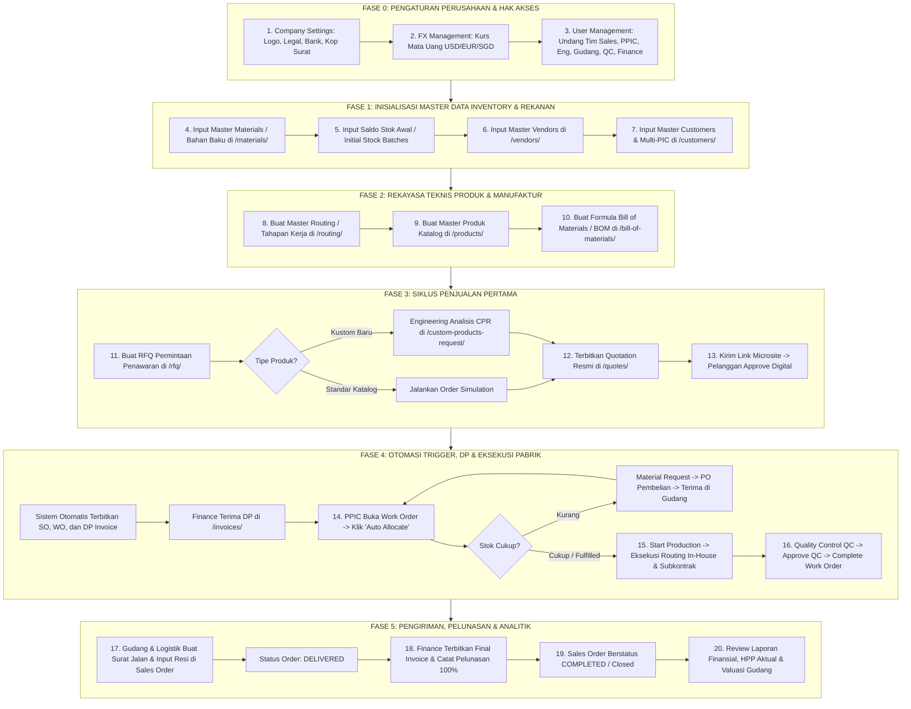

# PANDUAN LENGKAP PENGOPERASIAN LABAMU MRP DARI NOL (COLD START GUIDE)
## Dari Database Kosong, Inisialisasi Master Data, Transaksi Penjualan, Produksi, hingga Laporan Keuangan

Buku panduan ini disusun khusus untuk perusahaan manufaktur/pabrik yang **baru pertama kali menggunakan Labamu MRP dengan kondisi sistem yang masih benar-benar kosong (*fresh install / 0 data*)**.

---

## PETA TAHAPAN SETUP & OPERASIONAL DARI NOL

---

# FASE 0: PENGATURAN AWAL PERUSAHAAN & HAK AKSES

Saat pertama kali login dengan akun Owner (Nomor HP Terverifikasi):

### 1. Konfigurasi Profil Perusahaan (`/company-settings/`)
1. Buka menu **Administration** $\to$ **Company Settings**.
2. **Informasi Dasar:**
   - Masukkan **Nama Resmi Perusahaan** (misal: *PT Presisi Logam Indonesia*).
   - Masukkan **Kode Singkat Perusahaan** (misal: *PLI*).
   - Unggah **Logo Perusahaan** (format PNG transparan / WebP) untuk kop surat otomatis.
3. **Legalitas & Pajak:**
   - Masukkan nomor **NPWP Perusahaan**.
   - Masukkan tarif default PPN (standar: `11%`).
4. **Alamat Pabrik & Kantor:**
   - Alamat operasional untuk pencetakan dokumen resmi Surat Jalan & Purchase Order.
5. **Rekening Bank Pembayaran:**
   - Masukkan Bank (misal: *Bank Mandiri / BCA*), Nomor Rekening, dan Nama Pemilik Rekening untuk dicantumkan pada Quotation dan Invoice.
6. Klik **"Save Settings"**.

---

### 2. Konfigurasi Nilai Tukar Valuta Asing (`/fx-management/`)
*Jika perusahaan melayani ekspor atau membeli bahan impor (USD, EUR, SGD).*
1. Buka menu **Administration** $\to$ **FX Management**.
2. Klik **"+ Add Currency Rate"**:
   - Mata Uang: `USD` $\to$ Nilai Kurs ke IDR: `Rp 16.200`.
   - Mata Uang: `SGD` $\to$ Nilai Kurs ke IDR: `Rp 12.100`.
3. Klik **"Save"**.

---

### 3. Mengundang Anggota Tim & Penetapan Hak Akses (`/user-management/user-groups/`)
1. Buka menu **Administration** $\to$ **User Management**.
2. Klik tombol **"+ Invite User"**:
   - Masukkan Nama Lengkap, Nomor WhatsApp, dan Email pengguna.
   - Pilih **Peran (Role)**:
     - *Sales:* Akses RFQ, Quotes, Pelanggan.
     - *Engineering:* Akses Routing, BOM, CPR.
     - *PPIC / Production:* Akses Work Orders, Material Allocation, Material Requests.
     - *Procurement:* Akses Vendors, Purchase Orders.
     - *Warehouse:* Akses Batch Gudang, Goods Receipt, Surat Jalan.
     - *QC Inspector:* Akses Validasi QC Work Order.
     - *Finance:* Akses Invoices, Rekonsiliasi Pembayaran, Laporan Keuangan.
3. Anggota tim login melalui nomor WhatsApp masing-masing dengan OTP.

---

# FASE 1: INISIALISASI MASTER DATA INVENTORY & REKANAN

Sistem yang kosong membutuhkan data bahan baku, stok awal, serta daftar rekanan.

### 4. Input Master Bahan Baku / Material (`/materials/`)
1. Buka menu **Resources** $\to$ **Materials**.
2. Klik tombol **"+ Add Material"**:
   - **SKU Material:** Kode unik (misal: `MAT-SS304-2MM`).
   - **Nama Material:** *Plat Stainless Steel 304 (2.0 mm)*.
   - **Kategori:** *Logam & Plat*.
   - **Klasifikasi ABC:**
     - **Kelas A:** Bernilai tinggi / komponen utama (Plat, Pipa, Motor).
     - **Kelas B:** Bernilai sedang (Kawat las, Gas Argon, Cat).
     - **Kelas C:** Bernilai rendah / fastener (Baut, Mur, Kardus box).
   - **Tipe Material:** *Raw Material* atau *Finished Component*.
   - **Satuan (UoM):** *Lembar, Batang, Tube, Pcs, Box, Zak, Roll*.
   - **Minimum Stock Risk:** Batas peringatan stok kritis (misal: `10`).
   - **Harga Beli Acuan (Average Cost):** Rp 1.450.000 / lembar.
3. Simpan seluruh bahan baku yang digunakan dalam produksi.

---

### 5. Input Saldo Stok Awal (*Initial Stock Batches*)
*Memasukkan stok fisik riil yang ada di rak gudang saat ini.*
1. Pada menu **Materials** $\to$ klik tab **Stock Batches**.
2. Klik tombol **"+ Batch Stock In / Initial Balance"**:
   - Pilih Material: `MAT-SS304-2MM`.
   - Nomor Batch: `BAT-20260901-001` (atau auto-generate).
   - Kuantitas Awal: `35` Lembar.
   - Biaya per Unit: `Rp 1.450.000`.
   - Lokasi Rak Gudang: `Gudang A - Rak Besi 01`.
   - Vendor Penyuplai: `PT Mega Baja Nusantara`.
3. Klik **"Submit Stock"**. Stok bahan kini aktif dan siap dialokasikan.

---

### 6. Input Master Vendor Rekanan (`/vendors/`)
1. Buka menu **Resources** $\to$ **Vendors** $\to$ klik **"+ Add Vendor"**.
2. Masukkan data penyuplai bahan baku dan **subkontraktor luar**:
   - **Vendor Bahan:** *PT Mega Baja Nusantara* (Termin: NET 30 Hari).
   - **Vendor Subkontrak:** *CV Warna Prima Coating* (Kategori: Subcontractor Powder Coating, Termin: NET 30 Hari).
3. Tambahkan kontak PIC (Nama, Nomor HP WhatsApp, Email).

---

### 7. Input Master Pelanggan (*Customers*) & Multi-PIC (`/customers/`)
1. Buka menu **Resources** $\to$ **Customers** $\to$ klik **"+ Add Customer"**.
2. Masukkan data perusahaan pembeli:
   - Nama Perusahaan: *PT Maju Makmur Mandiri*.
   - Alamat Kantor & Alamat Pengiriman Pabrik.
3. **Konfigurasi Multi-PIC (Penting):**
   - **PIC 1 (Approver):** Ir. Bambang Sutejo (`bambang@majumakmur.co.id` / `+628119876543`) $\to$ Role Portal: **`Approver`** (Berhak menyetujui penawaran secara sah pada link digital).
   - **PIC 2 (Viewer):** Rian Hidayat (Supervisor Lapangan) $\to$ Role Portal: **`Viewer`**.
4. Klik **"Save Customer"**.

---

# FASE 2: REKAYASA TEKNIS PRODUK & MANUFAKTUR

Sebelum menerima order, sistem harus mengetahui cara membuat produk jadi.

### 8. Membuat Master Routing / Tahapan Kerja (`/routing/`)
1. Buka menu **Manufacturing** $\to$ **Routing** $\to$ klik **"+ Create Routing"**.
2. Masukkan Kode: `ROUT-TBL-SS180`, Nama: *Fabrikasi Meja Stainless Heavy Duty*.
3. Susun urutan tahapan kerja:
   - **Tahap 1:** `ROUT-CUTTING` (In-House) $\to$ Standar jam: 1.5 jam, Upah operator: Rp 65.000/jam.
   - **Tahap 2:** `ROUT-BENDING` (In-House) $\to$ Standar jam: 1.0 jam, Upah operator: Rp 75.000/jam.
   - **Tahap 3:** `ROUT-WELDING` (In-House) $\to$ Standar jam: 3.0 jam, Upah operator: Rp 70.000/jam.
   - **Tahap 4:** `ROUT-POWDERCOAT` (**Outsource / Subkontrak**) $\to$ Estimasi biaya jasa: Rp 250.000/unit.
   - **Tahap 5:** `ROUT-ASSEMBLY` (In-House) $\to$ Standar jam: 1.0 jam, Upah operator: Rp 60.000/jam.
4. Simpan Routing. Total Lead Time dan Total Biaya Operasi akan terkalkulasi otomatis.

---

### 9. Membuat Master Produk Jadi (`/products/` $\to$ `/products/create/`)
1. Buka menu **Product** $\to$ **Product Catalog** $\to$ klik **"+ Add Product"**.
2. Masukkan Data:
   - **SKU:** `PROD-TBL-SS180`.
   - **Nama Produk:** *Meja Kerja Stainless Heavy Duty 180x90cm*.
   - **Kategori:** *Furnitur Industri*.
   - **Satuan:** *Unit*.
   - **Harga Jual Standar:** `Rp 6.850.000`.
   - Hubungkan dengan default Routing `ROUT-TBL-SS180`.
3. Klik **"Save Product"**.

---

### 10. Membuat Formula Bill of Materials / BOM (`/bill-of-materials/`)
1. Buka menu **Manufacturing** $\to$ **Bill of Materials** $\to$ klik **"+ Create BOM"**.
2. Pilih Produk: `PROD-TBL-SS180`, Kode BOM: `BOM-TBL-SS180-V1`.
3. Masukkan komponen material yang dibutuhkan untuk membuat **1 Unit Meja**:
   - `MAT-SS304-2MM` (Plat 2mm) $\to$ Qty: `1.5 Lembar`.
   - `MAT-PIPA-SS-2IN` (Pipa Hollow) $\to$ Qty: `3.0 Batang`.
   - `MAT-WELD-308L` (Kawat Las) $\to$ Qty: `0.5 Tube`.
   - `MAT-GAS-ARGON` (Gas Argon) $\to$ Qty: `0.4 Tabung`.
   - `MAT-CASTOR-4IN` (Roda Castor) $\to$ Qty: `4.0 Pcs`.
   - `MAT-BAUT-M8X20` (Baut & Mur) $\to$ Qty: `0.2 Box`.
4. Sistem otomatis menjumlahkan: **Total Biaya Material BOM = Rp 4.148.000**.
5. Klik **"Save & Activate BOM"**.

---

# FASE 3: SIKLUS TRANSAKSI PENJUALAN PERTAMA

### 11. Membuat Permintaan Penawaran / RFQ (`/rfq/`)
1. Buka menu **Sales** $\to$ **RFQ** $\to$ klik **"+ Create RFQ"**.
2. Pilih Customer: *PT Maju Makmur Mandiri*.
3. Target Tanggal Kirim: *15 Oktober 2026*.
4. Masukkan Item Permintaan:
   - **Opsi A (Produk Standar):** Pilih `PROD-TBL-SS180` $\to$ Qty: `10 Unit`.
   - **Opsi B (Produk Kustom):** Centang *Custom Product* $\to$ Input nama item khusus dan unggah gambar teknik CAD.
     - *Jika kustom:* Sistem otomatis membuat tiket di `/custom-products-request/`. Tim Engineering mengisi estimasi bahan & proses, lalu mengirimkan estimasi HPP kembali ke Sales.
5. Klik **"Submit RFQ"**.

---

### 12. Menerbitkan Surat Penawaran Harga / Quotation (`/quotes/`)
1. Buka menu **Sales** $\to$ **Quotes** $\to$ klik **"+ Create Quotation"** (atau konversi langsung dari RFQ).
2. Tentukan Syarat Komersial:
   - Pelanggan: *PT Maju Makmur Mandiri*.
   - Mata Uang: `IDR`.
   - Termin Pembayaran: **Down Payment 50%**.
   - Incoterms: *Loco Pabrik Cikarang*.
   - Masa Berlaku: *14 Hari*.
3. Masukkan Item: `10 Unit Meja` @ `Rp 6.850.000` = `Rp 68.500.000` (+ PPN 11% = **Rp 76.035.000**).
4. Klik **"Generate Quotation"**.

---

### 13. Persetujuan Digital Pelanggan (*Microsite Approval*)
1. Pada detail Quotation, klik tombol **"Share Approval Link"** $\to$ Salin tautan unik Microsite.
2. Kirimkan tautan tersebut ke PIC Approver klien via WhatsApp / Email.
3. Klien membuka Microsite (tanpa perlu login):
   - Klien memeriksa rincian penawaran resmi.
   - Klien mengunggah nomor/file PO Pelanggan (`PO-MMM-2026-089`).
   - Klien menandatangani persetujuan secara digital $\to$ Klik **"Approve Quotation"**.
4. **OTOMASI SISTEM (Auto-Triggers Seketika):**
   - Status Quotation berubah menjadi **`APPROVED`**.
   - Sistem **otomatis membuat Sales Order** (`SO-2026-0038`).
   - Sistem **otomatis membuat Work Order** (`WO-2026-0041`).
   - Sistem **otomatis membuat Faktur Uang Muka (DP Invoice)** sebesar 50% (`Rp 38.017.500`).

---

# FASE 4: PEMBAYARAN DP & EKSEKUSI PRODUKSI PABRIK

### 14. Alokasi Bahan Baku di Work Order (`/work-orders/`)
1. Buka menu **Manufacturing** $\to$ **Work Order** $\to$ Buka `WO-2026-0041`.
2. Klik tombol biru **"Auto Allocate Materials"**.
3. Sistem menghitung kebutuhan 10 unit meja:
   - Plat 2mm: butuh 15 lembar (Stok ada 35 lembar) $\to$ **Teralokasi**.
   - Pipa Hollow: butuh 30 batang (Stok ada 80 batang) $\to$ **Teralokasi**.
   - Roda: butuh 40 pcs (Stok ada 88 pcs) $\to$ **Teralokasi**.
4. Semua baris hijau $\to$ Status WO otomatis berubah menjadi **`ALLOCATED`**.

---

### 15. Menjalankan Produksi (*Shopfloor Tracking*)
1. Klik tombol **"Start Production"** $\to$ Status WO: **`IN_PROGRESS`**.
2. Masuk ke tab **Routing**:
   - **Tahap 1 (Cutting):** Operator mesin laser memotong plat $\to$ Input jam aktual: 15 jam $\to$ Klik *Complete Step*.
   - **Tahap 2 (Bending):** Operator mesin CNC menekuk plat $\to$ Input jam aktual: 10 jam $\to$ Klik *Complete Step*.
   - **Tahap 3 (Welding):** Welder mengelas rangka meja $\to$ Input jam aktual: 30 jam $\to$ Klik *Complete Step*.
   - **Tahap 4 (Powder Coating - Subkontrak):**
     1. Klik **"Release to Vendor"**.
     2. Pilih vendor: *CV Warna Prima Coating*, konfirmasi biaya Rp 2.500.000 untuk 10 unit meja.
     3. Sistem otomatis membuat PO Subkontrak dan mencetak **Surat Jalan Subkontrak**.
     4. Barang dikirim ke vendor.
     5. Setelah barang selesai dicoating dan kembali: Buka `/purchase-orders/` $\to$ Buka PO Subkontrak $\to$ Tab *Receipts* $\to$ Catat penerimaan 10 unit meja.
     6. Tahap 4 di Work Order otomatis tercentang **`COMPLETED`**.
   - **Tahap 5 (Assembly & Pasang Roda):** Operator merakit roda dan baut $\to$ Klik *Complete Step*.

---

### 16. Quality Control & Penyelesaian Work Order
1. Setelah seluruh tahapan routing selesai, status WO menjadi **`QUALITY_CONTROL`**.
2. QC Inspector memeriksa produk:
   - Passed Qty: `10 Unit`, Rejected: `0`.
   - Klik **"Approve QC"**.
3. Klik tombol **"Complete Work Order"**:
   - **Efek 1:** Stok batch bahan baku otomatis terpotong permanen dari gudang.
   - **Efek 2:** Stok barang jadi bertambah 10 unit di katalog `/products/`.
   - **Efek 3:** Status Sales Order pelanggan otomatis berubah menjadi **`READY_TO_SHIP`**.

---

# FASE 5: PENGIRIMAN, PELUNASAN & ANALISIS

### 17. Pengemasan & Pengiriman Barang (`/orders/`)
1. Buka menu **Sales** $\to$ **Orders** $\to$ Buka Sales Order `SO-2026-0038`.
2. Tim Logistik menyiapkan pengemasan kardus dan bubble wrap.
3. Klik **"Create Delivery / Shipping"**:
   - Cetak **Surat Jalan Pengiriman Resmi (Delivery Note)**.
   - Masukkan nomor resi / nomor polisi armada truk (misal: *B 9876 PLI*).
   - Status Sales Order berubah menjadi **`ON_SHIPPING`**.
4. Supir mengantar barang ke pabrik *PT Maju Makmur Mandiri* $\to$ Meminta tanda tangan BAST / Surat Jalan.
5. Logistik mengunggah foto BAST yang sudah ditandatangani $\to$ Status Order menjadi **`DELIVERED`**.

---

### 18. Faktur Pelunasan & Penutupan Order (`/invoices/`)
1. Buka menu **Sales** $\to$ **Invoices**.
2. Buka **Final Settlement Invoice** sisa 50% (`Rp 38.017.500`).
3. Kirimkan faktur pelunasan beserta salinan BAST ke bagian keuangan klien.
4. Saat pembayaran pelunasan masuk ke rekening bank:
   - Klik **"Record Payment Settlement"** $\to$ Masukkan tanggal, nominal, dan bukti transfer.
   - Status Invoice berubah menjadi **`PAID`**.
5. **Sales Order otomatis berstatus `COMPLETED` (Closed / Sukses Sepenuhnya).**

---

### 19. Evaluasi & Analisis Laporan Keuangan (`/reports/`)
1. **Laporan Laba Rugi Per Order (`/reports/financial/`):**
   - Pendapatan: `Rp 68.500.000` (sebelum PPN).
   - Biaya Bahan Baku Riil: `Rp 41.480.000`.
   - Biaya Operasional & Subkontrak: `Rp 7.800.000`.
   - **Total HPP Aktual:** `Rp 49.280.000`.
   - **Laba Kotor Riil:** **Rp 19.220.000 (Margin 28.05%)**.
2. **Laporan Valuasi Gudang (`/reports/inventory/`):**
   - Memeriksa sisa saldo bahan baku dan barang jadi yang terikat sebagai aset lancar.
3. **Laporan Utilisasi Produksi (`/reports/work-order/`):**
   - Evaluasi apakah jam kerja aktual operator sesuai dengan estimasi standar routing.

---

## CHECKLIST VERIFIKASI SEBELUM GO-LIVE PABRIK

- [ ] Seluruh data profil perusahaan, kop surat, dan rekening bank sudah terisi di `/company-settings/`.
- [ ] Seluruh akun staff sudah diundang dengan peran (Role) yang tepat di `/user-management/user-groups/`.
- [ ] Master material sudah terinput lengkap dengan klasifikasi ABC dan stok awal batch di `/materials/`.
- [ ] Vendor rekanan (termasuk subkontraktor luar) sudah terdaftar di `/vendors/`.
- [ ] Pelanggan sudah terdaftar dengan kontak PIC Approver di `/customers/`.
- [ ] Routing tahapan kerja (in-house vs outsource) sudah dibuat di `/routing/`.
- [ ] Katalog produk sudah terdaftar di `/products/`.
- [ ] Formula BOM sudah terpasang dan berstatus aktif di `/bill-of-materials/`.
- [ ] Uji coba 1 siklus simulasi order di `/order-simulation/` untuk memverifikasi margin dan kesiapan sistem.
