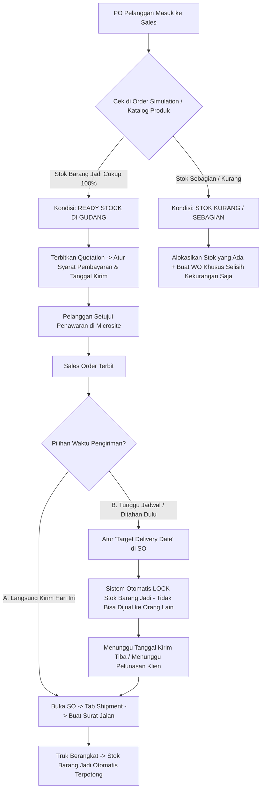

# PANDUAN PENGELOLAAN STOK BARANG JADI (MAKE TO STOCK / READY STOCK)
## Cara Labamu MRP Menangani Stok Gudang, Pengiriman Instan, Jadwal Tunda, & Mencegah Hutang

Dokumen ini menjelaskan secara detil bagaimana sistem **Labamu MRP** menangani model bisnis **Make to Stock (MTS)** — yaitu perusahaan yang terbiasa memproduksi dan menyimpan barang jadi di gudang, sehingga saat ada PO dari pelanggan masuk:
1. **Bisa langsung dikirim seketika (*Instant Dispatch*)**.
2. **Bisa ditahan/dijadwalkan kirim beberapa waktu kemudian (*Scheduled Delivery*)**.
3. **Mencegah timbulnya hutang finansial (piutang macet / cashflow minus) maupun hutang produksi (double production / overstock).**

---

## 1. DUA SKENARIO UTAMA BARANG READY STOCK DI LABAMU MRP



---

## 2. CARA MENCEGAH "HUTANG" DI LABAMU MRP

Istilah "Hutang" dalam operasional manufaktur memiliki 3 bentuk yang dapat dicegah oleh sistem Labamu:

```
+---------------------------------------------------------------------------------------------------------------+
|                                CARA LABAMU MRP MENCEGAH 3 JENIS HUTANG                                        |
+------------------------------------+------------------------------------+-------------------------------------+
| 1. HUTANG PIUTANG (FINANSIAL)      | 2. HUTANG PRODUKSI (OVERSTOCK)     | 3. HUTANG STOK / SELISIH FISIK      |
+------------------------------------+------------------------------------+-------------------------------------+
| Masalah:                           | Masalah:                           | Masalah:                            |
| Barang sudah dikirim tapi pembeli  | Barang sudah ada di gudang, tapi   | 1 barang ready diperebutkan oleh 2  |
| tidak bayar (Piutang Macet/Hutang).| pabrik malah bikin baru lagi dari  | sales berbeda sehingga stok minus.  |
|                                    | nol (pemborosan modal bahan baku). |                                     |
| Solusi Labamu:                     | Solusi Labamu:                     | Solusi Labamu:                      |
| Pasang termin **DP 100% (CBD)**    | Gunakan fitur **Order Simulation** | Sistem menerapkan **Stock Lock /    |
| pada Quotation. Surat Jalan & Resi | & Bypass WO. Sistem memotong stok  | Reserved Allocation**. Begitu SO    |
| dikunci sebelum faktur berstatus   | barang jadi yang sudah ready tanpa | terbit, stok FG terkunci untuk PO   |
| "PAID".                            | perlu menyalakan mesin pabrik.     | tersebut dan tidak bisa dijual lagi.|
+------------------------------------+------------------------------------+-------------------------------------+
```

---

## 3. PANDUAN KLIK-DEMI-KLIK: MENGELOLA READY STOCK

---

### LANGKAH 1: CARA MEMBUAT STOK BARANG JADI UNTUK DISIMPAN DI GUDANG (*PRODUKSI BUFFER STOK*)
*Lakukan ini saat pabrik memproduksi barang untuk stok cadangan (bukan karena ada pesanan orang).*

1. Di menu sidebar kiri $\to$ Klik **"Manufacturing"** $\to$ Klik **"Work Order"** $\to$ Klik **"+ Create Work Order"**.
2. **Pilih Produk**: Pilih `Meja Kerja Stainless 180x90cm` $\to$ Masukkan kuantitas (misal: `50 Unit`).
3. Tautkan formula BOM & Routing $\to$ Klik **"Auto Allocate Materials"** (bahan baku di gudang teralokasi).
4. Klik **"Start Process"** $\to$ Operator kerjakan di pabrik sampai selesai.
5. Klik tombol hijau **"Complete Work Order"**.
6. **Hasilnya:** Stok produk jadi di menu **Product $\to$ Product Catalog (`/products/`)** otomatis bertambah **`+50 Unit Ready Stock`** di rak gudang.

---

### LANGKAH 2: SAAT ADA PO DARI PELANGGAN MASUK (CEK KETERSEDIAAN)

1. Pelanggan mengirim PO (misal: Pesan `10 Unit Meja`).
2. Di sidebar kiri $\to$ Klik **"Tools"** $\to$ Klik **"Order Simulation"**:
   - Masukkan nama produk: `Meja Kerja Stainless 180x90cm`.
   - Masukkan kuantitas: `10 Unit`.
   - Klik **"Run Simulation"**.
3. **Hasil Simulasi:**
   - Baris **Inventory Stock Status** berwarna hijau **`100% Available in Warehouse`** (Artinya barang ready fisik, tidak butuh tunggu pabrik bikin).
   - Lead time: `0 Hari (Ready to Ship)`.

---

### LANGKAH 3: BUAT PENAWARAN & KUNCI PEMBAYARAN (*AGAR TIDAK JADI PIUTANG MACET*)

1. Di sidebar kiri $\to$ Klik **"Sales"** $\to$ Klik **"Quotes"** $\to$ Klik **"+ Create Quotation"**.
2. Pilih Customer: `PT Maju Makmur Mandiri`.
3. Masukkan item: `10 Unit Meja`.
4. **PENGATURAN KUNCI AGAR TIDAK JADI HUTANG:**
   - **Opsi A (Cash Before Delivery - 100% Aman):**
     - Pada kolom **Down Payment (DP %)**: Isi `100%`.
     - *Artinya:* Pembeli wajib transfer lunas 100% sebelum barang boleh dimuat ke truk.
   - **Opsi B (Termin NET 30 - Khusus Customer Terpercaya):**
     - Pada kolom **Payment Terms**: Pilih `NET 30 Days`.
     - Pasang DP `50%`, sisa `50%` jatuh tempo 30 hari setelah BAST diterima.
5. Klik **"Generate Quotation"** $\to$ Kirim link persetujuan ke klien via tombol **"Share Approval Link"**.
6. Klien menyetujui di HP $\to$ **Sales Order resmi terbit**.

---

### LANGKAH 4: PILIHAN EKSEKUSI PENGIRIMAN

Setelah Sales Order terbit, Anda memiliki 2 opsi tergantung permintaan pembeli:

---

#### PILIHAN A: BARANG LANGSUNG DIKIRIM HARI INI (*INSTANT DISPATCH*)
*Gunakan jika pembeli minta barang langsung dikirim saat itu juga.*

1. Di sidebar kiri $\to$ Klik **"Sales"** $\to$ Klik **"Orders"** $\to$ Buka Sales Order terkait.
2. Karena barang ready stock, status pesanan langsung **`READY TO SHIP`**.
3. Buka bagian **"Shipment Section"** $\to$ Klik **"Create Delivery / Surat Jalan"**.
4. **Isi form pengiriman:**
   - Pilih armada: *Truk Engkel Perusahaan* (No Polisi: `B 9876 PLI`).
   - Masukkan nama driver: `Maman Suparman`.
   - Klik **"Print Delivery Note (Surat Jalan)"**.
5. Klik tombol **"Save & Dispatch"**:
   - Status Sales Order berubah menjadi **`On Shipping`**.
   - **Stok barang jadi di katalog gudang `/products/` otomatis terpotong seketika (dari 50 unit berkurang jadi 40 unit).**
6. Setelah supir menyerahkan barang ke pelanggan dan BAST ditandatangani:
   - Unggah foto BAST di menu Sales Order $\to$ Klik **"Mark as Delivered"**.

---

#### PILIHAN B: BARANG READY TAPI MENUNGGU BEBERAPA WAKTU BARU DIKIRIM (*SCHEDULED DELIVERY*)
*Gunakan jika pembeli sudah PO sekarang, tapi pabrik mereka baru siap menerima barang 2 minggu atau 1 bulan lagi.*

1. Buka Sales Order terkait di menu **Sales $\to$ Orders**.
2. Pada kolom **Target Delivery Date**: Masukkan tanggal pengiriman yang diminta pembeli (misal: *20 Oktober 2026*).
3. **APA YANG DILAKUKAN SISTEM LABAMU?**
   - Sistem secara otomatis memasukkan 10 unit barang tersebut ke dalam status **`Allocated / Reserved for SO-XXXX`**.
   - **Keamanan:** 10 unit meja ini **terkunci di sistem**, sehingga tim sales lain tidak bisa menjual 10 meja ini ke customer lain, meskipun fisiknya masih tersimpan di gudang kita.
   - Status order tetap rapi dalam antrian *Scheduled Delivery*.
4. **Saat Tanggal Pengiriman Tiba (20 Oktober 2026):**
   - Admin Gudang membuka Sales Order $\to$ Buka tab **Shipment** $\to$ Klik **"Create Delivery"** $\to$ Cetak Surat Jalan $\to$ Muat barang ke truk dan berangkatkan.

---

## 4. BAGAIMANA JIKA STOK GUDANG HANYA ADA SEBAGIAN? (*HYBRID FULFILLMENT*)

*Contoh Kasus:* Customer pesan **50 unit**, tetapi di gudang ready stock hanya ada **30 unit** (kurang 20 unit).

```
+-----------------------------------------------------------------------------------------------+
|                                  SKEMA HYBRID FULFILLMENT                                     |
+-----------------------------------------------------------------------------------------------+
| Total Pesanan PO: 50 Unit Meja                                                                |
|   ├── 30 Unit (Ambil Langsung dari Stok Gudang) ──────> Siap Kirim / Di-reserve               |
|   └── 20 Unit (Kekurangan / Shortage) ───────────────> Dibuatkan Work Order Pabrik Selisihnya |
+-----------------------------------------------------------------------------------------------+
```

### Cara Penanganan di Labamu MRP:
1. Saat Quotation disetujui $\to$ Work Order terbit.
2. Buka Work Order $\to$ Kuantitas produksi disesuaikan hanya untuk memproduksi **`20 Unit`** kekurangannya saja.
3. Pabrik hanya memotong bahan baku untuk 20 unit (menghemat modal dan waktu kerja).
4. Setelah 20 unit selesai dibuat di pabrik $\to$ Sistem menggabungkan 30 unit dari gudang + 20 unit baru selesai $\to$ Total 50 unit siap dikirim bersamaan ke pelanggan.

---

## 5. REKONSILIASI KEUANGAN & PENUTUPAN TRANSAKSI (AGAR TIDAK ADA HUTANG MENGGANTUNG)

1. Di sidebar kiri $\to$ Klik **"Sales"** $\to$ Klik **"Invoices"**.
2. Buka faktur terkait:
   - Jika menggunakan DP 100%: Status invoice sudah `Paid`.
   - Jika menggunakan termin sisa pelunasan: Setelah barang diterima pembeli (*Delivered*), kirimkan final invoice beserta lampiran BAST fisik.
3. Saat dana pelunasan masuk ke rekening bank:
   - Klik **"Add Payment"** di dalam invoice $\to$ Masukkan nominal & bukti transfer $\to$ Status invoice menjadi **`Paid (100%)`**.
4. **Sistem Labamu otomatis menutup pesanan:**
   - Status Sales Order menjadi **`COMPLETED` (Closed)**.
   - Tidak ada piutang menggantung (*Zero Bad Debt*).
   - Tidak ada stok selisih (*Zero Inventory Variance*).
