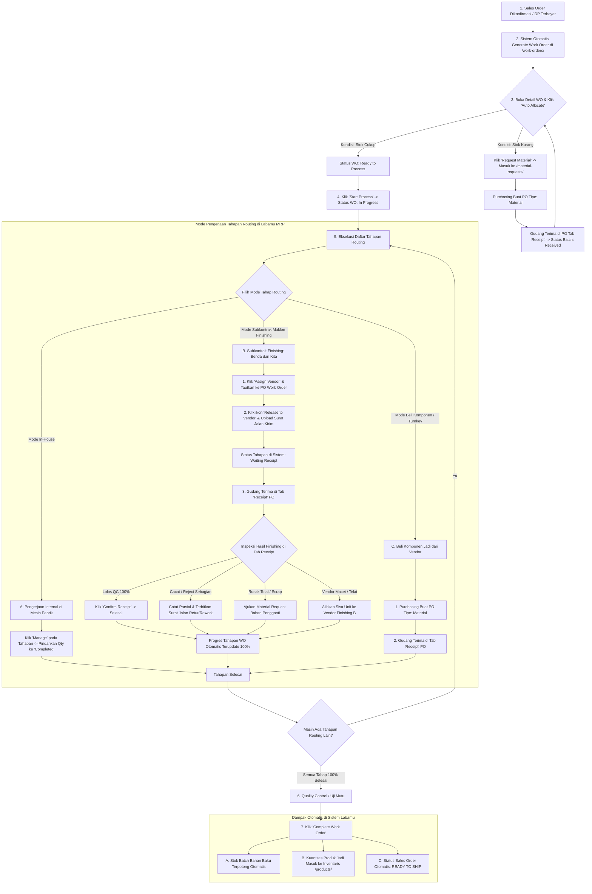
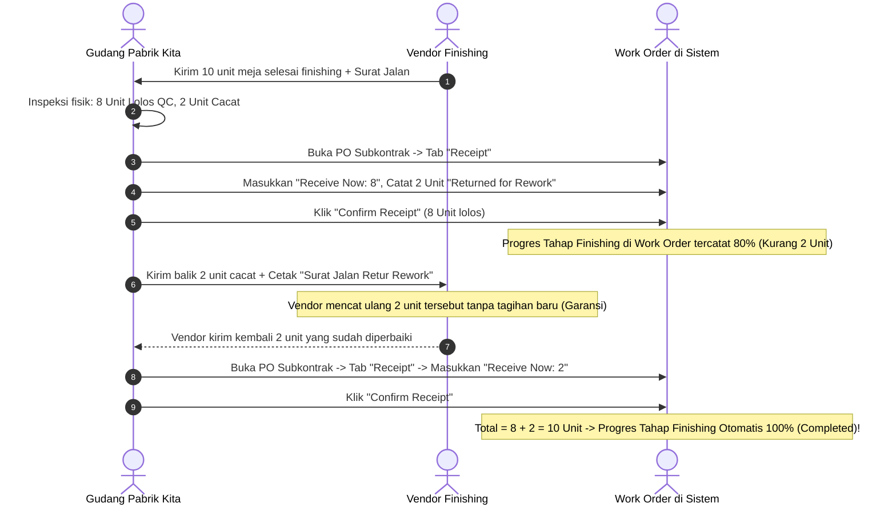

# DOKUMENTASI FLOW PRODUKSI, SUBKONTRAK & PENANGANAN KENDALA FINISHING
## Berdasarkan Fitur, Logika, dan Mekanisme Asli Sistem Labamu Manufacturing

Dokumen ini memetakan seluruh alur proses manufaktur pada sistem **Labamu MRP** (`https://mrp.labamu.co.id/`) secara faktual, mencakup model **Make to Order (MTO)**, model **Make to Stock (MTS / Ready Stock)**, penanganan 2 jalur subkontrak (*Maklon vs Turnkey*), multi-vendor, serta **SOP penanganan kendala khusus pada vendor finishing (material dari kita)**.

---

## 1. PETA ALUR PRODUKSI UTAMA (MASTER WORKFLOW)



---

## 2. PENANGANAN 4 KENDALA KHUSUS PADA VENDOR FINISHING (*Bahan dari Kita*)

Proses finishing luar (seperti *Powder Coating, Hard Chrome, Anodizing, Galvanizing, Sandblasting, dan Pengecatan Oven*) seringkali menghadapi kendala di lapangan karena **benda kerja fisiknya berasal dari pabrik kita**.

Berikut adalah cara sistem Labamu MRP mengatasi **4 masalah utama finishing**:

```
+---------------------------------------------------------------------------------------------------------------+
|                       CARA SISTEM LABAMU MRP MENGATASI 4 KENDALA VENDOR FINISHING                             |
+------------------------------------+------------------------------------+-------------------------------------+
| KASUS 1: HASIL CACAT / REJECT QC   | KASUS 2: BARANG RUSAK / HILANG     | KASUS 3: VENDOR FINISHING TELAT     |
+------------------------------------+------------------------------------+-------------------------------------+
| Masalah:                           | Masalah:                           | Masalah:                            |
| 10 unit dikirim, saat balik 2 unit | 1 unit meja penyok parah / hilang  | Vendor A macet / over capacity,     |
| cat mengelupas / baret.            | di pabrik vendor saat diproses.    | pesanan harus cepat dikirim.        |
|                                    |                                    |                                     |
| Solusi Labamu MRP:                 | Solusi Labamu MRP:                 | Solusi Labamu MRP:                  |
| 1. Di PO Receipt: Input 8 unit     | 1. Di PO Receipt: Terima 9 unit    | 1. Tarik sisa unit dari Vendor A.   |
|    "Receive Now", 2 unit ditolak.  |    (1 unit dicatat rusak/scrap).   | 2. Di Work Order: Assign Vendor B   |
| 2. Progres WO terisi 80%.          | 2. Klik "Request Material" di WO   |    untuk sisa unit yang belum jadi. |
| 3. Terbitkan "Surat Jalan Retur    |    untuk ambil plat/bahan pengganti| 3. Terbitkan PO baru ke Vendor B    |
|    Rework" ke vendor (Rp 0).       | 3. Operator pabrik bikin 1 unit.   |    -> Release ke Vendor B -> Terima |
| 4. Saat 2 unit selesai diperbaiki  | 4. Kirim ke vendor via Release baru|    di PO Vendor B.                  |
|    -> Terima di PO -> Progres 100%.| 5. Potong tagihan jasa vendor.     | 4. Progres WO genap 100% selesai.   |
+------------------------------------+------------------------------------+-------------------------------------+
| KASUS 4: PERBEDAAN HARGA / BIAYA TAMBAHAN (SURCHARGE CHEMICAL / OVEN KHUSUS)                          |
+-------------------------------------------------------------------------------------------------------+
| Solusi Labamu MRP:                                                                                    |
| Update unit price di Purchase Order Subkontrak sebelum approval keuangan. Nilai HPP aktual produk     |
| di sistem otomatis mengkalkulasi kenaikan biaya finishing tersebut secara transparan.                |
+-------------------------------------------------------------------------------------------------------+
```

---

### 2.1. SOP KASUS 1: HASIL FINISHING CACAT / REWORK (*Cat Baret, Mengelupas, Belang*)
*Contoh:* Kirim 10 unit meja ke *CV Warna Prima Coating*. Saat kembali, **8 unit mulus**, **2 unit cat mengelupas**.



#### Langkah-Langkah di Sistem Labamu MRP:
1. **Pencatatan Parsial di PO Receipts (`/purchase-orders/[id]`):**
   - Buka PO Subkontrak $\to$ Tab **Receipt**.
   - Pada kolom **Receive Now**, masukkan angka `8`.
   - Unggah foto surat jalan vendor dan foto bagian cat yang cacat sebagai bukti dokumentasi.
   - Klik **"Confirm Receipt"**.
   - *Status Sistem:* Work Order otomatis mencatat progres **8 dari 10 unit selesai (80%)**. Sistem tidak akan menutup tahapan ini sampai 2 unit sisanya berstatus diterima.
2. **Penerbitan Surat Jalan Retur Rework:**
   - Bagian gudang mencetak dokumen **Surat Jalan Pengeluaran Barang (Kategori: Retur Pengerjaan Ulang / Rework)** untuk membawa 2 unit tersebut kembali ke fasilitas vendor.
3. **Penerimaan Sisa Unit Rework:**
   - Setelah 2 unit selesai dicat ulang dan tiba di pabrik $\to$ Buka kembali tab **Receipt** pada PO yang sama.
   - Masukkan angka `2` pada kolom **Receive Now** $\to$ Klik **"Confirm Receipt"**.
   - **Otomatis!** Progres tahapan finishing di Work Order langsung tuntas **100% (Completed)**.

---

### 2.2. SOP KASUS 2: BARANG RUSAK TOTAL / HILANG OLEH VENDOR (*Scrapped by Vendor*)
*Contoh:* 1 unit meja terjatuh di tempat vendor hingga rangkanya patah/penyok parah dan tidak bisa diperbaiki lagi.

#### Langkah Penanganan di Sistem:
1. **Konfirmasi Penerimaan Unit yang Selamat:**
   - Di PO Receipt, terima `9 Unit` yang dalam kondisi baik.
   - Sisa `1 Unit` dicatat sebagai *Damaged / Scrapped*.
2. **Keluarkan Bahan Baku Pengganti di Work Order:**
   - Buka Work Order $\to$ Klik tombol **"Request Material"**.
   - Ajukan bahan baku tambahan dari gudang (1.5 lembar plat + 3 batang pipa) khusus untuk membuat 1 unit pengganti.
   - Tim internal pabrik memotong dan mengelas 1 unit rangka baru.
3. **Kirim Ulang 1 Unit ke Vendor Finishing:**
   - Pada tahapan finishing di Work Order, klik **Release to Vendor** $\to$ Masukkan kuantitas `1 Unit` $\to$ Cetak surat jalan pengiriman baru.
   - Saat 1 unit selesai dicat dan kembali $\to$ Gudang klik *Confirm Receipt* di PO.
   - Total kuantitas WO genap 10 unit.
4. **Klaim Ganti Rugi Finansial:**
   - Biaya bahan baku tambahan yang terpakai dapat dipotongkan langsung dari nilai tagihan faktur vendor finishing saat rekonsiliasi di modul Keuangan (`/invoices/`).

---

### 2.3. SOP KASUS 3: VENDOR FINISHING MACET / GANTI VENDOR (*Vendor Replacement*)
*Contoh:* Vendor A (*CV Warna Prima*) mengalami kerusakan mesin oven sehingga proses finishing 10 unit meja macet, padahal tanggal pengiriman pesanan ke customer sudah sangat mendesak.

#### Langkah Penanganan di Sistem:
1. **Tarik Barang Kembali dari Vendor A:**
   - Ambil seluruh barang setengah jadi dari fasilitas Vendor A.
   - Jika Vendor A sempat menyelesaikan 3 unit $\to$ Catat *Receipt 3 Unit* pada PO Vendor A.
   - Jika belum ada yang selesai $\to$ Batalkan alokasi sisa di PO Vendor A.
2. **Alihkan Sisa Unit ke Vendor Finishing B (*PT Cikupa Coating*):**
   - Buka Work Order $\to$ Pada tahapan finishing yang sama, klik **Assign Vendor** kedua.
   - Pilih vendor baru: `PT Cikupa Coating Mandiri`.
   - Masukkan kuantitas sisa: `7 Unit` (atau `10 Unit`).
   - Tautkan ke PO baru untuk Vendor B.
3. **Pelepasan & Penerimaan di Vendor B:**
   - Klik **Release to Vendor B** $\to$ Unggah surat jalan kirim ke Tangerang.
   - Saat Vendor B selesai dan mengirim barang $\to$ Gudang buka tab *Receipt* pada PO Vendor B $\to$ Klik **Confirm Receipt**.
   - Sistem mengakumulasi total penerimaan dari Vendor A dan Vendor B hingga genap 10 unit $\to$ Status tahapan finishing di Work Order otomatis **`Completed`**.

---

## 3. MATRIKS RINGKASAN AKSI SISTEM

| Kendala Lapangan | Tindakan di Work Order | Tindakan di Modul PO / Gudang | Dampak Finansial / Stok |
| :--- | :--- | :--- | :--- |
| **Cat Cacat Sebagian** | Status tahap tetap terbuka (*Progress 80%*). | Terima parsial (8 unit) di PO Receipt $\to$ Kirim 2 unit retur $\to$ Terima 2 unit sisa di PO yang sama. | Tidak ada tambahan biaya jasa (Garansi Vendor). |
| **Barang Rusak Total** | Klik **Request Material** untuk bahan pengganti 1 unit $\to$ Buat baru. | Terima 9 unit di PO Receipt $\to$ Rilis 1 unit pengganti $\to$ Terima 1 unit sisa. | Klaim potong tagihan jasa vendor senilai bahan yang rusak. |
| **Ganti Vendor di Tengah Jalan** | Klik **Assign Vendor** kedua untuk sisa kuantitas pada tahap yang sama. | Buat PO baru ke Vendor B $\to$ Rilis ke Vendor B $\to$ Gudang konfirmasi terima di PO B. | HPP mengakumulasi tagihan riil dari Vendor A + Vendor B. |
| **Normal (Tanpa Kendala)** | Klik **Assign Vendor** $\to$ Klik **Release to Vendor**. | Buka PO $\to$ Tab **Receipt** $\to$ Masukkan *Receive Now* $\to$ Klik **Confirm Receipt**. | Progres WO otomatis terupdate 100% Completed. |
